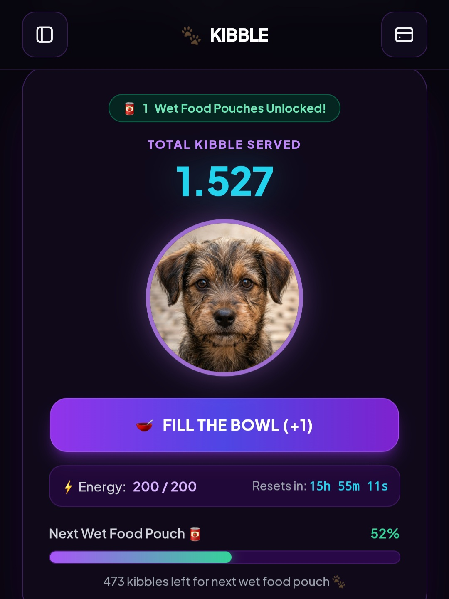
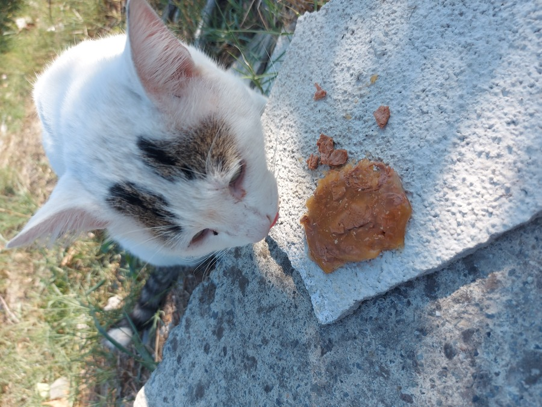
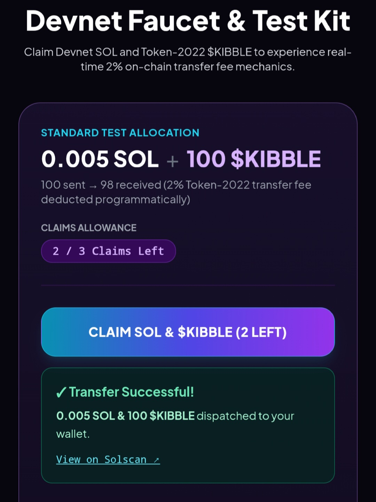
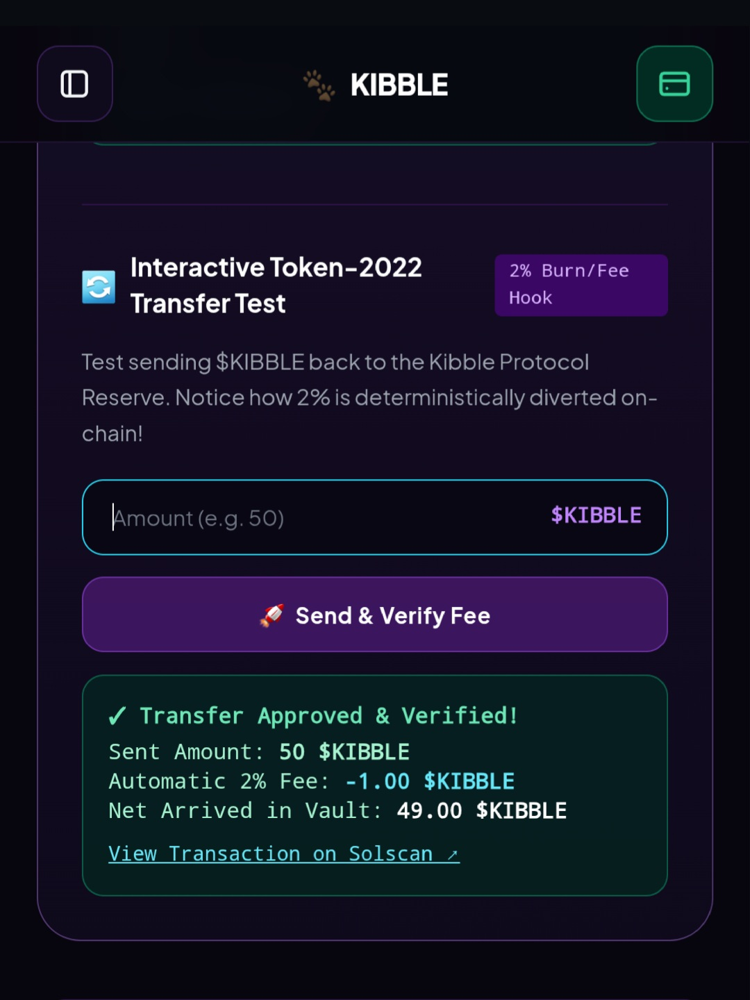

# 🐾 Kibble ($KIBBLE) - Impact-First Protocol on Solana

> **Not just a tap-to-feed game — an automated, on-chain animal welfare protocol powered by Solana.**

---

## 🌟 Overview

**Kibble** is an impact-focused Web3 protocol built on Solana. It transforms on-chain transaction volume and user engagement into an automated funding mechanism that provides food to stray animals through **Token-2022 transfer fees**.

- 🌐 **Live Web dApp:** [kibble-sol.github.io/Kibble/](https://kibble-sol.github.io/Kibble/)
- ✈️ **Telegram Hub:** [@kibblesol](https://t.me/kibblesol)
- 🐦 **X (Twitter):** [@kibblesol](https://x.com/kibblesol)

---

## ⚙️ Core Architecture & Workflow

The end-to-end flow of our protocol is as follows:

1. **Step 1 (User Engagement - [#tracker](https://kibble-sol.github.io/Kibble/#tracker)):** A lightweight frontend tracking and feeding interface designed to involve users in community engagement and drive high user acquisition. Check it live: [kibble-sol.github.io/Kibble/#tracker](https://kibble-sol.github.io/Kibble/#tracker).
2. **Step 2 (On-Chain Value Engine - Token-2022):** A smart contract-level automated 2% transfer fee deduction on token transfers, routed directly to the animal feeding treasury without intermediaries.
3. **Step 3 (Simulation & Testing - [#faucet](https://kibble-sol.github.io/Kibble/#faucet)):** An infrastructure enabling users to request test SOL and $KIBBLE on Devnet to live-test transfer fee mechanisms. Test it live: [kibble-sol.github.io/Kibble/#faucet](https://kibble-sol.github.io/Kibble/#faucet).
4. **Step 4 (Real-World Impact - Proof of Feed):** Converting accumulated treasury funds into physical food, distributing it to stray animals, and verifying it via on-chain / video evidence.

---

## 🎮 Part 1: Tap-to-Feed dApp & Real-World Impact

The layer where users interact on the frontend to boost community metrics, turning treasury funds into physical food on the streets.

| 🎮 Tap-to-Feed dApp ([#tracker](https://kibble-sol.github.io/Kibble/#tracker)) | 🐾 Real-World Examples (Proof of Impact) |
| :---: | :---: |
|  |  |
| *Frontend tracking interface where users interact.* | *Proof of Feed: Real-world distribution.* |

🔗 **Explore the tracker live:** [kibble-sol.github.io/Kibble/#tracker](https://kibble-sol.github.io/Kibble/#tracker)

---

## 🧪 Part 2: Devnet Integration & On-Chain Systems

The backend infrastructure running on Solana Devnet, testing faucet integration and the 2% transfer fee redirection.

| 🧪 Devnet Integration & Faucet ([#faucet](https://kibble-sol.github.io/Kibble/#faucet)) #1 | 🧪 Devnet Integration & Faucet ([#faucet](https://kibble-sol.github.io/Kibble/#faucet)) #2 |
| :---: | :---: |
|  |  |
| *Live Devnet faucet testing and token claim flow.* | *Protocol execution and transaction monitoring screen.* |

🔗 **Test the Devnet faucet live:** [kibble-sol.github.io/Kibble/#faucet](https://kibble-sol.github.io/Kibble/#faucet)

---

## 📂 Repository Structure

- `api/` - Faucet and serverless backend routing scripts
- `assets/` - Brand assets, screenshots, and impact proof media files
- `bot/` - Telegram automation engine and requirements
- `CONTRIBUTING.md` - Contribution guidelines
- `Kibble-Litepaper.pdf` - Official project litepaper document
- `LICENSE` - MIT License
- `README.md` - Project documentation
- `SECURITY.md` - Security and disclosure policy
- `index.html` - Web dApp interface and Web3 client logic
- `package.json` - Project configurations

---

## 🚀 Quick Start & Local Setup

Run the dApp locally in seconds:

1. Clone the repository: `git clone https://github.com/kibble-sol/Kibble.git`
2. Navigate to the folder: `cd Kibble`
3. Open the `index.html` file in your browser.

---

## 🗺️ Roadmap #1

- [x] **01. Ideation & Concept**
  - Transforming transaction volume into shelter aid using Solana Token-2022 architecture.
- [ ] **02. Core Infrastructure Setup**⏳
  - Web application, Token-2022 transfer fee configuration, and Litepaper.
- [ ] **03. Public Devnet Testing**⏳
  - Devnet deployment, faucet integration ([#faucet](https://kibble-sol.github.io/Kibble/#faucet)), and fee collection testing.
- [ ] **04. Mainnet Launch**
  - 10M fixed supply, 100% LP burn, and live 2% fee redirection.
- [ ] **05. First Verifiable Donation**
  - On-chain SOL transfer to partner shelter and feeding proof.
- [ ] **06. Full Community Governance**
  - Deployment of Quadratic Voting DAO portal.

---

## 🛠 Tech Stack

- **Blockchain:** Solana (Token-2022 with Transfer Fee Extension)
- **Frontend:** Vanilla HTML5 / CSS3 / JavaScript
- **Backend & API:** Node.js / Serverless Faucet Logic (`api/`)
- **Database:** Firebase Realtime Database
- **Bot Engine:** Python (`bot/`)
- **Deployment:** GitHub Pages

---

*Built with ❤️ for stray animals.*
